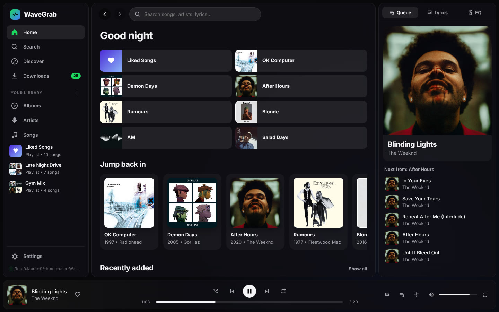

# WaveGrab

A Spotify-style music player that runs **100% on your own PC**: your own music files, your own folders, no account, no streaming. It has the WaveGrab downloader built in, so you can find albums online and pull them straight into your library.

## What it does

- **Your library, from your files.** It reads tags (title, artist, album, track number, year, genre, cover art) straight from your music, on your external drive and/or your Music folder. If you unplug the drive, its songs stay in the library and come back when you plug it in.
- **Browse like Spotify.** Home, Albums, Artists, Songs, Liked Songs and playlists, with album and artist pages, a queue, and a now-playing bar.
- **Search everything, including lyrics.** Full-text search (SQLite FTS5 + BM25 ranking) across titles, artists, albums, genres and **lyrics**. Click a lyric match to jump straight to that line in the song.
- **See what you don't have.** Search results, artist discographies and albums show music from the internet with a clear **Not saved** badge. Your albums show which tracks are missing. One click downloads them.
- **Download queue, powered by spotDL.** A dedicated page with drag-to-reorder, move to top, hold/resume, cancel, retry, pause all, and live progress. spotDL finds each song using Spotify's data and YouTube Music; if it can't, WaveGrab's own YouTube search takes over. Paste Spotify, YouTube, YouTube Music or SoundCloud links like classic WaveGrab.
- **Albums stay in order.** Album downloads are saved as `01 Title`, `02 Title`… so they sort in track order everywhere. **Settings → Organize library** does the same for the music you already have: it looks up the official track order online when your tags don't have it, and removes duplicate songs from albums (with a preview first, and undo).
- **No duplicates, no 1-song "albums".** Downloads skip songs an album already has, missing tracks are saved into the existing album folder, and lone songs show up under Songs and the artist's "Singles & loose songs" instead of as albums.
- **Music videos.** Save videos from Downloads ("Music video") and watch them on their own page with a full-window player.
- **Synced lyrics.** Reads `.lrc` files next to your songs (or embedded lyrics) and highlights each line as it's sung. Downloads fetch lyrics from LRCLIB automatically.
- **Sound.** 10-band EQ with presets, crossfade, and three shuffle styles: *Fewer repeats* (default), *Balanced artist spread*, and *Standard*.
- **Looks.** 8 themes, a soft background glow that pulses with the music, and colours that match the playing album.

## Running it (Windows)

1. Install **Python 3.11+** from python.org (tick "Add to PATH").
2. Double-click **`start-wavegrab.bat`**. The first run installs everything, including spotDL and (through spotDL) FFmpeg if you don't have it, then WaveGrab opens in its own window.
3. In **Settings → Music folders**, add your external drive's music folder (for example `E:\Music`). WaveGrab finds an external drive's `Music` folder by itself if there is one.

Manual start: `pip install -r requirements.txt` then `python run.py` (add `--browser` to use a browser tab instead of a window).

**Updates:** every time WaveGrab opens, it checks GitHub for a new version and installs it before starting. This works whether you cloned the repo with git or downloaded the zip. You can turn this off in Settings → Updates.

### Optional
- If YouTube ever asks you to confirm you're not a bot, go to **Settings → Downloads → Use browser cookies** and pick your browser.
- A YouTube Music Premium `cookies.txt` unlocks 256 kbps audio.

## Keyboard
| Key | Action |
|---|---|
| Space | Play / pause |
| ← / → | Seek 5 s |
| Shift + ← / → | Previous / next song |
| ↑ / ↓ | Volume |
| `/` or Ctrl+K | Search |
| L | Lyrics |

## Where things are stored
- Your music stays where it is. Downloads go to `<download folder>/<Album Artist>/<Album>/<NN Title>.m4a` (plus a `.lrc` lyrics file).
- App data (library index, settings, cover cache) lives in `%APPDATA%\WaveGrab`.

See [docs/ARCHITECTURE.md](docs/ARCHITECTURE.md) for how it works and [docs/CHANGELOG.md](docs/CHANGELOG.md) for what changed.
